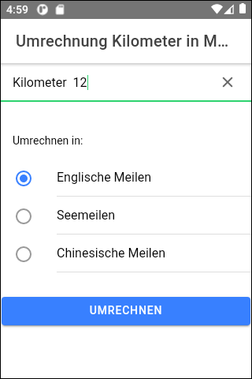
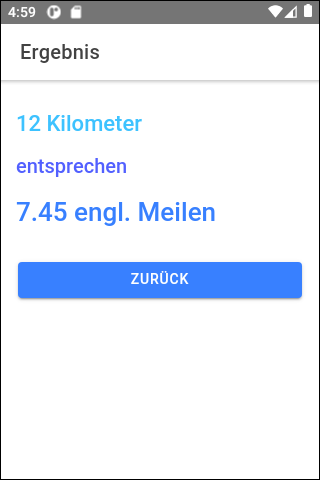

# Ionic-App "Kilometer-Umrechung" #

 

Einfache App mit [Ionic](https://ionicframework.com), um einen Wert in Kilometern in verschiedene Meileneinheiten umzurechnen.

 

Eine Variante dieser App als native Anwendung finden Sie in [diesem Repository](https://github.com/MDecker-MobileComputing/Android_KilometerUmrechnung).

 

----

## Screenshots ##

 

 &nbsp; 

 

Die App kann unter der folgenden URL direkt im Browser getestet werden:

https://mdecker-mobilecomputing.github.io/Ionic_KilometerUmrechnung

 

----

## License ##

 

See the [LICENSE file](LICENSE.md) for license rights and limitations (BSD 3-Clause License)
for the files in this repository.

 
